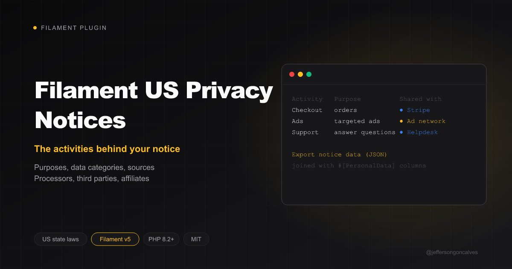

<div class="filament-hidden">



</div>

# Filament US Privacy Notices

[](https://packagist.org/packages/jeffersongoncalves/filament-us-privacy-notices)
[](https://github.com/jeffersongoncalves/filament-us-privacy-notices/actions?query=workflow%3Atests+branch%3A3.x)
[](https://github.com/jeffersongoncalves/filament-us-privacy-notices/actions?query=workflow%3A"Fix+PHP+code+styling"+branch%3A3.x)
[](https://packagist.org/packages/jeffersongoncalves/filament-us-privacy-notices)
[](LICENSE.md)

The processing activities behind your US state privacy notice, managed in your Filament panel, built on [laravel-us-privacy-notices](https://github.com/jeffersongoncalves/laravel-us-privacy-notices): purposes, categories of personal data, sources, recipients by role (processor, third party, affiliate) and retention.

> This plugin gives you tooling. It does not make you compliant on its own.

## Features

- Create and edit processing activities, linked to the models whose `#[PersonalData]` columns they use.
- Recipients by role: third parties and the categories shared with them go into the notice.
- Export the notice data as JSON.
- 19 languages.

## Compatibility

| Plugin Version | Filament |
|---|---|
| [1.x](https://github.com/jeffersongoncalves/filament-us-privacy-notices/tree/1.x) | 3.x |
| [2.x](https://github.com/jeffersongoncalves/filament-us-privacy-notices/tree/2.x) | 4.x |
| [3.x](https://github.com/jeffersongoncalves/filament-us-privacy-notices/tree/3.x) | 5.x |

## Installation

```bash
composer require jeffersongoncalves/filament-us-privacy-notices:"^3.0"
```

Install and configure [laravel-us-privacy-notices](https://github.com/jeffersongoncalves/laravel-us-privacy-notices) first, and render the notice with its `<x-us-privacy-notices::privacy-policy />` component.

## Usage

```php
use JeffersonGoncalves\Filament\UsPrivacyNotices\UsPrivacyNoticesPlugin;

public function panel(Panel $panel): Panel
{
    return $panel
        ->plugins([
            UsPrivacyNoticesPlugin::make()
                ->navigationGroup('Privacy')   // default: no group
                ->navigationSort(2)
                ->slug('processing-activities'),
        ]);
}
```

All fluent methods are optional.

> The pages have no authorization of their own: register the plugin only on panels whose users may see them, or override `canAccess()` in a subclass.

## Related plugins

- [filament-us-privacy](https://github.com/jeffersongoncalves/filament-us-privacy): personal data inventory and the state law rules.
- [filament-us-privacy-opt-out](https://github.com/jeffersongoncalves/filament-us-privacy-opt-out): opt-outs, sensitive data consent and Global Privacy Control.
- [filament-us-privacy-requests](https://github.com/jeffersongoncalves/filament-us-privacy-requests): consumer requests and appeals.
- [filament-us-privacy-assessments](https://github.com/jeffersongoncalves/filament-us-privacy-assessments): data protection assessments.
- [filament-us-privacy-vendors](https://github.com/jeffersongoncalves/filament-us-privacy-vendors): processors and third parties.
- [filament-us-privacy-minors](https://github.com/jeffersongoncalves/filament-us-privacy-minors): age checks, guardians and minors' consent.

## Testing

```bash
composer test
```

## Changelog

Please see [CHANGELOG](CHANGELOG.md) for more information on what has changed recently.

## Contributing

Please see [CONTRIBUTING](.github/CONTRIBUTING.md) for details.

## Security Vulnerabilities

Please review [our security policy](../../security/policy) on how to report security vulnerabilities.

## Credits

- [Jefferson Gonçalves](https://github.com/jeffersongoncalves)
- [All Contributors](../../contributors)

## License

The MIT License (MIT). Please see [License File](LICENSE.md) for more information.
